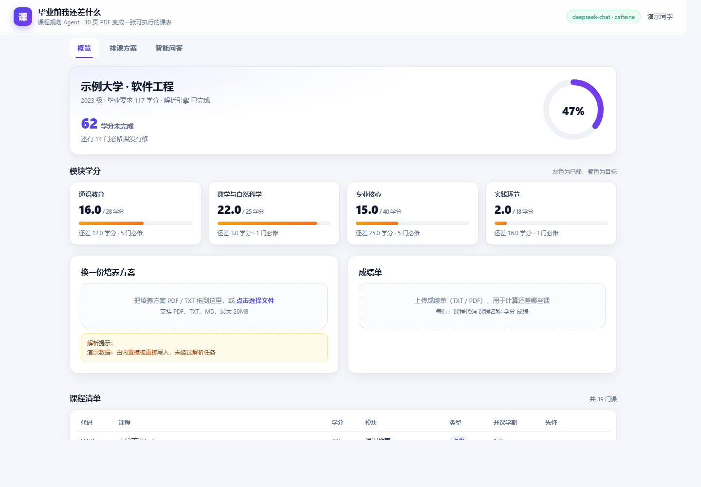
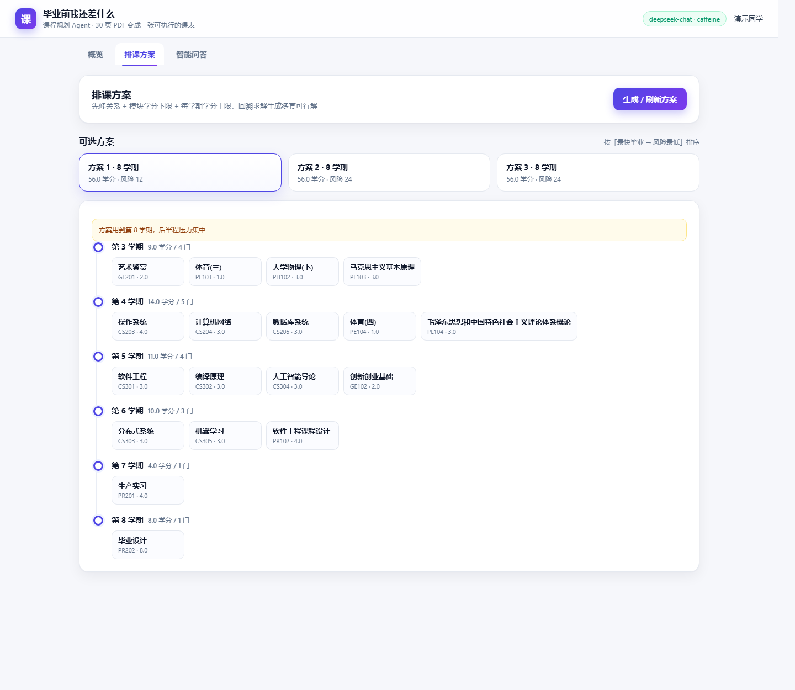
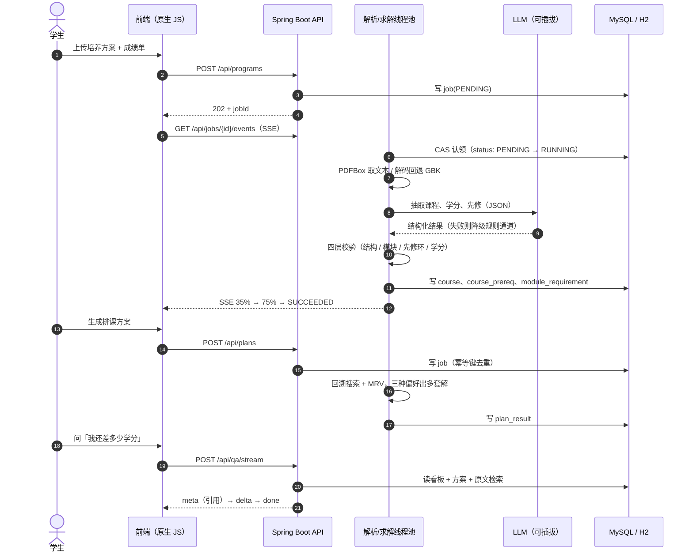

<div align="center">

<h2>CoursePilot</h2>

<p>
  <a href="https://github.com/Xiangyfff/course-pilot/stargazers"></a>
  
  
  
  
  
  
  
  
  
  <a href="./LICENSE"></a>
</p>

面向毕业审核的 <strong>课程规划 Agent</strong>。

把一份 30 页的培养方案 PDF，变成一张能照着排的课表。

**代码**：<https://github.com/Xiangyfff/course-pilot>

</div>

## 项目预览

**学分进度（解析完成后自动汇总模块缺口）**



**排课方案（多套可行解 + 风险提示 + 学期时间线）**



## 起因

每学期选课都要翻学院那份 30 页的培养方案：先修关系写在课程简介的句子里，模块学分要求散在几张表里。想知道「毕业还差什么」，只能一页页对数。有人到大四才发现漏了一门先修，只能延毕。

CoursePilot 的做法是：上传培养方案和成绩单，后台把文本解析成课程、学分、先修关系，再用约束求解器排出后面每学期该修什么，最后允许你就着这份方案追问。

**核心原则：模型负责翻译，不负责决策。** 排课交给可验证的算法——模型会编出根本不存在的课程，更麻烦的是当它说「排不出来」时，你没法判断是真无解还是它没想明白。

## 核心功能

培养方案解析天然是**长耗时、结果必须可核对、外部调用按次计费**的场景，四条链路都围绕这个前提展开。

### 🧾 异步、可恢复的解析任务

> 读完整份文档再调模型，几十秒是常态，不能堵在 HTTP 线程里。

- **提交即返回** — `POST /api/programs` 只写一行 `job(PENDING)` 就返回 `jobId`，解析在独立线程池里跑，前端用 SSE 收进度（35% → 75% → SUCCEEDED）。
- **一条 SQL 完成认领** — `UPDATE job SET status='RUNNING' WHERE id=? AND status='PENDING'`，影响行数为 0 就说明任务已被别人抢走，天然幂等。
- **超时重排 + 围栏令牌** — 卡在 RUNNING 超过 300 秒的任务会被重新排队；旧线程结束时写回状态要带 `AND version = :fencing`，命中 0 行只留一条 warn，不会把新线程正在跑的任务改成 SUCCEEDED。
- **失败分级** — 文档里一条课程都识别不出来，属于重试也没用的错误，直接进死信；只有网络抖动这类才退避重试三次。

### 🧩 模型只做它擅长的那一段

> 模型会把「一、通识教育（最低 24 学分）」整行抄进模块字段，也会漏掉不带冒号的「先修EN101」。

- **可插拔引擎** — `mock` 走正则抽取，`openai-compatible` 走任意兼容端点（DeepSeek、Ollama）；模型返回 401 时自动降级到规则通道，任务仍然成功，只在告警里写明原因。
- **四层校验兜底** — 结构 → 模块补全 → 先修闭环（DFS 三色删环）→ 学分守恒。模型输出只是候选，入库前必须过完这四关。
- **名称与代码归一** — 模型给中文模块名、库里存的是 `GE`，先建 name→code 映射再写库，同时清洗「一、」「（最低 X 学分）」这类标题噪声，避免凭空多出几个 0 学分模块。
- **评测集驱动改 prompt** — 12 份文档 × 4 种排版跑同一套评分，规则通道课程识别 F1 65.9%、先修边 28.4%；补上「先修的四类写法」规则后，先修边从 66.7% 提到 100%。

### 🔁 排课交给可验证的算法

> 「排不出来」必须能被证明，而不是模型的一句话。

- **CSP 建模** — 变量是每门课放第几学期，约束是先修严格更早、每学期学分不超上限、只在开课学期可选、总学期数不超过 8。
- **拓扑序 + 同层 MRV** — 按先修深度升序排，保证落位时先修已经确定；同层再优先排「可选学期少、学分重」的课。最初按深度降序做 MRV，结果先修和后修被排进同一学期，是被单测抓出来的。
- **三种偏好出多套解** — 最早毕业 / 学期最空 / 后置，去重后按「最快毕业 − 风险最低」排序；风险分来自学分是否顶到上限、先修间隔是否只隔一学期。
- **有对照实验** — 每学期上限收紧到 13 学分时，无回溯的贪心 300 次全部排不出，带回溯的求解器 300 次全部排完，单次 0.2 ms。宽松约束下贪心够用但更慢，这个结论写在对比表里。

### 🔍 回答要能点回原文

> 不可溯源的回答，在「毕业还差什么」这种问题上只能当聊天看。

- **先检索再组织** — 从培养方案原文按中文二字组重合度取前三段，与看板统计、最新方案一起进上下文；接了模型就由模型组织语言，没接就用模板拼。
- **流式三条消息** — SSE 依次推 `meta`（引用片段）、`delta`（逐字）、`done`；前端用 `fetch + ReadableStream` 自己解析，因为 `EventSource` 带不了 `Authorization` 头。
- **引擎可见** — 同一个接口，`engine` 字段直接告诉你是 `llm:deepseek-chat` 还是 `template`，页面右上角的胶囊也会变。
- **会话留痕** — 问答写进 `qa_message`，后面做多轮上下文和评测都靠它。

### 🤖 问答不是一次生成，是个有工具调用的循环

> 「模型直接答」和「模型先去查再答」，在 45 条评测上最稳的差别不是空回答，是**事实命中 95% → 100%**：同一份方案里明明写着「每学期 25 学分」，经典模式三次都答「没有写」。

- **三个只读工具** — `get_progress`（学分与模块缺口）、`solve_plan`（最近一次方案）、`search_program`（培养方案原文检索）。模型每轮只输出 `{"thought","tool","args"}` 或 `{"thought","final"}`，执行结果作为观察回灌，最多 3 轮。
- **只读，不越权** — 工具不会提交求解任务、不会改方案；模型能把「帮我把课排松一点」翻译成查询条件，但落库仍走原来的确定性路径。
- **失败不炸** — 工具不存在、抛异常、超时都转成观察文本回给模型；JSON 连续两次解析失败就中止并回落经典模式；轮数用尽时再调一次强制收束。
- **可切换、可对比** — `QA_MODE=classic`（一次检索 + 一次生成）或 `agent`（工具循环），同一套接口、同一个前端，评测脚本能直接跑两条基线。

## 系统流程



## 技术栈

| 层次 | 技术 | 用途 |
| :--- | :--- | :--- |
| 后端 | Java 17、Spring Boot 3.5.16、Bean Validation | REST API、参数校验、任务调度 |
| 数据访问 | JdbcClient、NamedParameterJdbcTemplate | 手写 SQL，批量写入，执行计划可控 |
| 存储 | MySQL 8（`profile=mysql`）、H2（`dev` 内存库） | 11 张业务表 |
| 迁移 | Flyway | 同一套 DDL 跑两个库 |
| 缓存 | Caffeine（默认）、Redis（`CACHE_MODE=redis`） | 方案与抽取结果缓存 |
| 异步 | 进程内线程池（`parsePool=4` / `solvePool=2`）、`JobDispatcher` 接口 | 任务状态机、CAS 认领、补偿、死信 |
| 鉴权 | 手写 HS256 JWT、BCrypt | 无状态登录，不引 Spring Security 全套 |
| 文档解析 | Apache PDFBox 3.0.3 | PDF 取文本，UTF-8 严格解码失败退 GBK |
| AI | 可插拔 `LlmClient`：`mock` / `openai-compatible` | DeepSeek、Ollama 或任意兼容端点 |
| 算法 | 回溯搜索（CSP）、拓扑排序、MRV 剪枝 | 先修约束下的多方案排课 |
| Agent | 手写工具调用循环、`ToolRegistry`、最多 3 轮 | 问答先查后答，工具执行结果回灌 |
| 集成 | MCP（stdio / JSON-RPC 2.0） | 把三个只读工具暴露给 Cursor、Claude Desktop |
| 前端 | 原生 JS、手写 CSS、SSE | 三个页面，零构建，Spring Boot 直接托管 |
| 部署 | Docker 多阶段构建、Docker Compose | 镜像约 858 MB，MySQL 走 `mysql` profile |

## 性能与评测

本机 16C/32T、Windows + Docker Desktop（MySQL 8），不是线上环境：

| 场景 | 结果 |
| :--- | :--- |
| 解析入库（MySQL，40 门课） | p50 **139 ms**（批量写之前 200 ms） |
| 排课出 3 套方案 | H2 **12 ms** / MySQL **29 ms** |
| 看板接口 50 并发 | **2477 QPS**，p99 44.7 ms |
| 20 并发上传（真模型单份 3.4 s） | 提交 72 ms，排队 p50 7.5 s |
| 抽取评测：课程识别 F1 | 规则 65.9% / 真模型 100% |
| 抽取评测：先修边 F1 | 规则 28.4% / 真模型 100% |
| 抽取耗时 | 规则 336 ms / 真模型 4.4 s |

评测集是程序生成的 12 份文档（4 种排版 × 3 种变体，27 门课 / 87 学分 / 18 条先修边），不是真实学校 PDF，绝对分数会偏高，边界写在 `eval/` 的注释里。复现脚本在 `samples/`：`bench.mjs`（单次耗时）、`load.mjs`（读接口并发）、`load-write.mjs`（写路径排队）。

### Agent 问答评测（45 条 × 3 次，`eval/agent-cases.json`）

用例分六层，每题跑 3 次——LLM 有随机性，跑一次得到的「85%」可能只是运气，所以看的是三次都过的**稳定通过率**：

| 维度 | 用例 | pass@1 | 三次都过 | 平均耗时 |
| :--- | :--- | :--- | :--- | :--- |
| 单工具 | 8 | 100% | 100% | 2707 ms |
| 多工具 | 8 | 87.5% | 87.5% | 3685 ms |
| 不该调工具（越界） | 8 | 100% | 100% | 1382 ms |
| 多轮指代 | 6 | 83.3% | 83.3% | 2850 ms |
| 异常与边界 | 8 | 100% | 100% | 3534 ms |
| 数值精确 | 7 | 100% | 100% | 2277 ms |
| **合计** | **45** | **95.6%** | **95.6%** | **2744 ms** |

135 次调用里 129 次通过，平均 1.13 个工具调用（其中 0.13 次是同一工具换参数重查）。6 次失败中 5 次是**多调了一个工具**、1 次少调，没有一次答错事实。

**评测抓出来两个真 bug（都已修）**：

1. 问「隔壁计算机学院的方案多少学分」，模型拿自己方案的 117 顶替。提示词缺作用域约束——工具只覆盖本人这一份方案。加了「问到别的专业/学校直接说没有」之后归零。
2. 问「专业核心还差几门必修课」，`get_progress` 只返回模块学分、没返回门数，模型只能去检索课表还查不到。补上 `coursesLeft` 字段后归零。**pass@1 从 88.9% 提到 95.6%** 就是这两处带来的。

同一批 45 条 × 3 次，两条通道对照：

| 指标 | 经典模式 | Agent 模式 |
| :--- | :--- | :--- |
| 事实命中（有标准答案的 20 条） | 95%（57/60） | **100%（60/60）** |
| 空回答 | 0/135 | 0/135 |
| 平均引用片段数 | 2.20 | **2.66** |
| 平均耗时 | **1117 ms** | 2744 ms |

一句自我修正：上一版 20 条评测里写的「空回答 10% → 0%」在 45 条上**复现不出来**，经典模式一次都没空过。真正稳定的差别是事实命中，以及「文档里写着的数字，经典模式会答没有写」。旧的那个 10% 别引用。

## 本地运行

### 环境要求

| 组件 | 要求 | 说明 |
| :--- | :--- | :--- |
| JDK | 17 | 后端运行环境 |
| Maven | 无需安装 | 仓库自带 `mvnw` / `mvnw.cmd` |
| Docker | 可选 | 只有走容器部署或 MySQL 时才需要 |
| LLM Key | 可选 | 不填则使用 `mock` 规则引擎，全链路可跑 |

确认命令可用：

```bash
java -version
docker compose version   # 可选
```

### 1. 直接启动（H2 内存库，零外部依赖）

```bash
cd course-planner
./mvnw spring-boot:run          # Windows: mvnw.cmd spring-boot:run
```

打开 `http://127.0.0.1:18080`，演示账号 `demo / demo1234`（页面会自动登录）。默认 `dev` profile 用 H2 内存库，Flyway 建表并播种一套示例数据，启动约 20 秒。

确认服务可用：

```bash
curl http://127.0.0.1:18080/api/health
# {"status":"UP","llm":"mock","mq":"local","cache":"caffeine"}
```

### 2. 换成真模型

编辑 `.env`（`application.yml` 里配了 `spring.config.import: optional:file:.env[.properties]`，没有这个文件也不报错）：

```properties
LLM_PROVIDER=openai-compatible
LLM_BASE_URL=https://api.deepseek.com/v1
LLM_API_KEY=sk-你的key
LLM_MODEL=deepseek-chat
```

重启后 `/api/health` 的 `llm` 会变成 `openai-compatible`，页面右上角胶囊显示 `deepseek-chat`。密钥只放本地 `.env`，已在 `.gitignore` 里，不要提交。

### 3. 用 MySQL 跑（可选）

```bash
docker compose --profile mysql up -d mysql      # 宿主机 3307，避开本机 3306
SPRING_PROFILES_ACTIVE=mysql DB_PORT=3307 ./mvnw spring-boot:run
```

### 4. 用容器跑（可选）

```bash
docker compose up --build        # http://127.0.0.1:18080
```

镜像约 858 MB，多阶段构建，Maven 依赖走 BuildKit cache mount 缓存。

### 5. 验证

```bash
./mvnw -B test                   # 29 个单元测试
bash samples/smoke.sh            # 13 步端到端，需要应用已在 18080 跑着
node eval/run-eval.mjs http://127.0.0.1:18080 eval/pred-llm.json && node eval/score.mjs eval/pred-rule.json eval/pred-llm.json
```

`samples/` 里有可直接上传的示例：一份 23 门课的培养方案、一份 13 门课的成绩单。

### 常见问题

| 现象 | 处理方式 |
| :--- | :--- |
| 18080 被占用 | `APP_PORT=18081 ./mvnw spring-boot:run` |
| 上传后任务卡在 RUNNING | 看 `/api/jobs/{id}`，超过 300 秒会被自动重排；日志里有 fence 警告说明重排生效了 |
| `/api/health` 里 `llm` 还是 `mock` | `.env` 里 `LLM_PROVIDER` 忘记改，或改完没重启 |
| 模型返回 401 | key 无效时会自动降级到规则通道，任务仍成功；检查 `.env` 的 `LLM_API_KEY` |
| 用 curl 传中文 JSON 报编码错 | Windows 命令行会把参数转成 GBK，改用 `--data-binary @file.json` |
| MySQL 连不上 | `docker compose --profile mysql ps` 确认容器健康，默认端口映射是 3307 |

### 打开 Agent 模式

```bash
QA_MODE=agent ./mvnw spring-boot:run
```

问「我还差多少学分」，回答下方会多一行工具轨迹（`get_progress · 7 ms`），右上角引擎胶囊变成 `agent:deepseek-chat`。轮数上限 `app.qa.max-steps`（默认 3）。

边界：工具都是只读的；模型不能自己触发求解任务，也不会改培养方案。轮数用尽会再调一次强制收束，所以「没查到」不会变成空回答。

### 记忆

`user_memory` 表存跨会话偏好，规则从问句里抽（不额外调模型）：早点毕业、想轻松点、别排早八、考研、实习。每轮问答把这些偏好拼进系统提示，所以第二句「那按这个排」不用再说一遍上下文。

```bash
curl -H "Authorization: Bearer $TOKEN" localhost:18080/api/memory
curl -X DELETE -H "Authorization: Bearer $TOKEN" localhost:18080/api/memory/pref:morning
```

规则抽取的取舍很直白：宁可漏，不要错。所以只认几种写法，代价是「我不想太累」这类没写进词典的说法记不住。

### MCP：把工具借给别的客户端

`mcp/server.mjs` 是一个 stdio 的 MCP server（JSON-RPC 2.0），把三个只读工具暴露给 Cursor / Claude Desktop。它本身是代理，真正干活的是已经跑起来的 Spring Boot：

```json
{
  "mcpServers": {
    "coursepilot": {
      "command": "node",
      "args": ["D:/dshddd/course-planner/mcp/server.mjs"],
      "env": { "COURSEPILOT_BASE": "http://127.0.0.1:18080" }
    }
  }
}
```

不配 token 时会自动用 `POST /api/auth/demo` 登录（所以只适合本地演示）。服务没启动时工具调用会直接报错，不会静默失败。

## 目录结构

```text
course-pilot
├── src/main/java/com/courseplanner/
│   ├── auth/          手写 JWT、参数解析、BCrypt
│   ├── program/       培养方案、课程、先修、模块
│   ├── transcript/    成绩单解析（同步执行）
│   ├── job/           任务状态机、CAS 认领、补偿、SSE
│   ├── extract/       PDF/文本解析、模型与规则抽取、校验链
│   ├── solve/         回溯求解器、方案、看板
│   ├── qa/            检索 + 流式回答 + 工具循环（agent/）+ 记忆（memory/）
│   └── demo/          示例数据播种
├── src/main/resources/static/    三个页面（index.html / style.css / app.js）
├── src/test/java/                29 个单元测试
├── eval/                         抽取评测 + Agent 问答评测（造数据 / 跑 / 打分）
├── mcp/                          MCP server（stdio，代理到本地服务）
├── samples/                      示例文件、冒烟与压测脚本
├── docs/screenshots/             界面截图
└── compose.yaml                  Docker Compose（app + mysql profile）
```

## 已知问题

- RocketMQ 适配器只有接口和配置位，实现没写，当前走进程内线程池
- 没有注册流程，账号来自播种数据
- 只解析 PDF / TXT，不解析 Word，也不做扫描件 OCR
- 评测集是合成语料，数字不能当线上准确率
- SSE 长连接没压过：每条连接一个轮询线程加一次 DB 查询，连接数上来会先打爆这里
- 求解器是启发式回溯，不保证最优解；40 门课这个规模够用
- Agent 模式没有并行工具调用，也没有自己重试失败的工具——失败就换下一个工具或收束
- 记忆抽取是关键词规则，说法稍微绕一点就记不住；也没有「忘记全部」之外的冲突处理
- MCP server 没有鉴权传递（自动演示登录），只适合本机，不能直接对公网开

## License

本项目基于 [MIT License](LICENSE) 开源。
